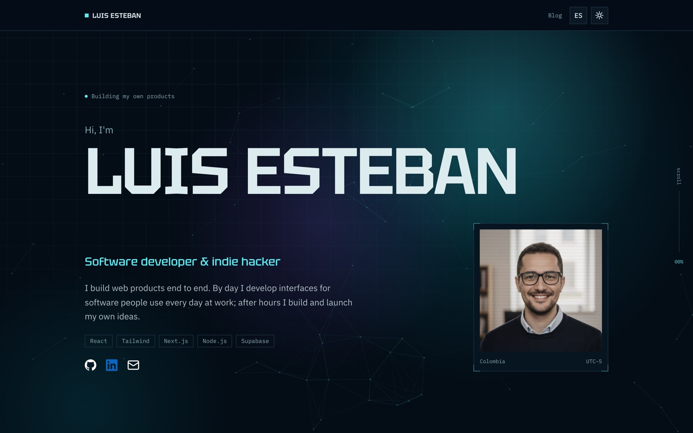
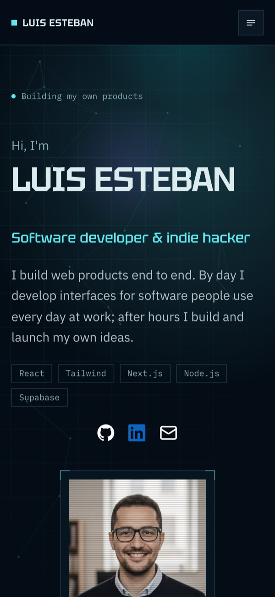
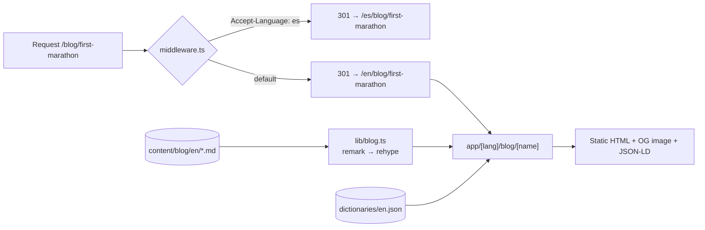

<p align="center">
  <a href="https://www.lesteban.dev/en">
    <picture>
      <source media="(prefers-color-scheme: light)" srcset=".github/assets/home-light.jpg">
      
    </picture>
  </a>
</p>

<h1 align="center">lesteban.dev</h1>

<p align="center">
  The personal site of <strong>Luis Esteban Ramírez</strong>, software developer and indie hacker from Colombia.<br>
  A bilingual portfolio and blog, designed as a living console.
</p>

<p align="center">
  <a href="https://www.lesteban.dev/en"><strong>Visit the site</strong></a> ·
  <a href="https://www.lesteban.dev/en/blog">Blog</a> ·
  <a href="https://www.linkedin.com/in/lestebanr/">LinkedIn</a> ·
  <a href="mailto:leramirezca@gmail.com">Email</a>
</p>

<p align="center">
  <a href="https://github.com/LEstebanR/lesteban/actions/workflows/test.yml"></a>
  <a href="https://github.com/LEstebanR/lesteban/actions/workflows/e2e.yml"></a>
  <a href="https://github.com/LEstebanR/lesteban/actions/workflows/typecheck.yml"></a>
  <a href="https://github.com/LEstebanR/lesteban/actions/workflows/lint.yml"></a>
</p>

---

## Hi, I'm Luis 👋

By day I build interfaces for software people use every day at work. After hours I build and launch my own products, like [UseChangelog](https://www.usechangelog.com) ([repo](https://github.com/LEstebanR/usechangelog)).

This repo is my corner of the web: who I am, what I've shipped and what I'm writing about, in English and Spanish. I also use it as a lab. It's where I try ideas on design, motion and front-end quality before they reach real products.

## What's worth a look

If you only have five minutes, these are the parts I'm proudest of:

|                                             |                                                                                                                                                                                                                                                                                                                |
| ------------------------------------------- | -------------------------------------------------------------------------------------------------------------------------------------------------------------------------------------------------------------------------------------------------------------------------------------------------------------- |
| 🎛️ **A design system with a point of view** | "Signal": OKLCH tokens, square corners, Tektur for display and IBM Plex for reading, all in light and dark. Written down in [`DESIGN.md`](DESIGN.md) and followed by every component. No template look: no stock icon set and no fade-in on every block.                                                       |
| 🌌 **Motion that means something**          | The hero name is scanned in once, and a canvas network of nodes reaches toward the pointer. The experience timeline fills as you scroll, through CSS scroll-driven animations (`animation-timeline`), with a static fallback where they're unsupported. Everything holds still under `prefers-reduced-motion`. |
| 🌍 **Bilingual by design**                  | `/en` and `/es` share one codebase. Middleware reads `Accept-Language` and sends bare URLs to the right locale with a 301. Pages publish `hreflang` alternates, and unknown paths return a real 404 instead of the home page.                                                                                  |
| ✍️ **A file-based blog**                    | Markdown in [`content/blog/`](content/blog), parsed with `gray-matter` and rendered through remark → rehype, with sanitizing and syntax highlighting. It also ships an RSS feed, `BlogPosting` JSON-LD, and a sitemap. `bun create:post` scaffolds a bilingual post.                                           |
| 🖼️ **Generated social cards**               | Every page and post gets its own Open Graph image, rendered at build time with Satori in the site's visual language.                                                                                                                                                                                           |
| ✅ **Quality gates that bite**              | **100% line and function coverage** is enforced in CI. On top of that: Playwright E2E for the home page, blog, i18n and 404s, strict TypeScript, ESLint, Prettier, and pre-commit hooks. There are also security headers (CSP, HSTS) and Vercel Analytics plus Speed Insights.                                 |

<p align="center">
  
</p>

## Tech stack

| Layer     | Choice                                                                                                                                                     |
| --------- | ---------------------------------------------------------------------------------------------------------------------------------------------------------- |
| Framework | [Next.js 16](https://nextjs.org) (App Router, Turbopack), React 19, TypeScript                                                                             |
| Styling   | [Tailwind CSS 4](https://tailwindcss.com) with OKLCH design tokens, Radix primitives through [shadcn/ui](https://ui.shadcn.com) (re-themed), `next-themes` |
| Type      | Tektur (display), IBM Plex Sans (body) and IBM Plex Mono (data), through `next/font`                                                                       |
| Content   | Markdown + `gray-matter`, `remark`/`rehype` with `rehype-highlight` and `rehype-sanitize`                                                                  |
| Testing   | `bun test` + Testing Library + happy-dom (unit), [Playwright](https://playwright.dev) (E2E)                                                                |
| Tooling   | [Bun](https://bun.sh), ESLint, Prettier (sorted imports), Husky + lint-staged                                                                              |
| Hosting   | [Vercel](https://vercel.com), with Web Analytics and Speed Insights                                                                                        |

## How it's built



There's no database: content and translations live in the repo, and every page is statically generated per locale.

```
app/
  [lang]/               Every page lives under a locale (en, es)
    page.tsx            Home: hero, experience, projects, skills, contact
    blog/               Blog index and post pages, each with its own OG image
    dictionaries/       UI strings: en.json, es.json
  feed.xml/             RSS feed
  sitemap.ts, robots.ts SEO
  globals.css           Design tokens, themes and every animation
components/             Page sections (hero, experience, projects…)
  cards/                Blog, project, experience and contact cards
  og/                   The Open Graph card layout
  ui/                   Primitives: buttons, header, footer, the icon set…
lib/
  blog.ts               getAllPosts, getPostByUrl, getAllPostUrls
  neural-field.ts       The maths behind the hero's node network
  data.ts, constants.ts Experience, projects and site constants
content/blog/{en,es}/   Posts, one Markdown file per language
middleware.ts           Locale detection and redirects
e2e/                    Playwright specs
```

## Run it locally

You need [Bun](https://bun.sh) 1.3+.

```bash
git clone https://github.com/LEstebanR/lesteban.git
cd lesteban
bun install
bun dev
```

Open http://localhost:3000. It redirects to `/en` or `/es` depending on your browser's language.

| Command                                     | What it does                                                 |
| ------------------------------------------- | ------------------------------------------------------------ |
| `bun dev`                                   | Dev server with Turbopack                                    |
| `bun run build`                             | Production build                                             |
| `bun test`                                  | Unit tests (`lib/`, `middleware.test.ts`, `tests/`)          |
| `bun test:coverage`                         | Unit tests with the 100% coverage threshold, as CI runs them |
| `bun test:e2e`                              | Playwright E2E tests                                         |
| `bun lint` · `bun typecheck` · `bun format` | ESLint, `tsc --noEmit` and Prettier                          |
| `bun create:post`                           | Interactive CLI to scaffold a bilingual blog post            |

## Built with AI, reviewed by a human

I work with [Claude Code](https://claude.com/claude-code) as a pair programmer, and this repo carries the setup. [`CLAUDE.md`](CLAUDE.md) holds the project rules, and [`.claude/commands/`](.claude/commands) has the workflows I reuse:

| Command                  | Purpose                                                                          |
| ------------------------ | -------------------------------------------------------------------------------- |
| `/dev-issue`             | Takes a Linear issue end to end: branch, implementation, commit and PR           |
| `/audit`                 | Audits performance, UI/UX, a11y, SEO, DX and i18n, then files prioritized issues |
| `/component`             | Creates a component that follows the design system                               |
| `/blog-post`             | Scaffolds a bilingual post with the right frontmatter                            |
| `/commit` · `/create-pr` | Conventional commits and PRs with the project's scopes                           |
| `/retrospective`         | Folds what a session taught back into these instructions                         |

Every change still goes through tests, CI and my review before it reaches `main`.

## Let's talk

I'm always happy to chat about product, front-end or indie hacking.

- 🌐 [lesteban.dev](https://www.lesteban.dev/en)
- 💼 [LinkedIn](https://www.linkedin.com/in/lestebanr/)
- ✉️ [leramirezca@gmail.com](mailto:leramirezca@gmail.com)
